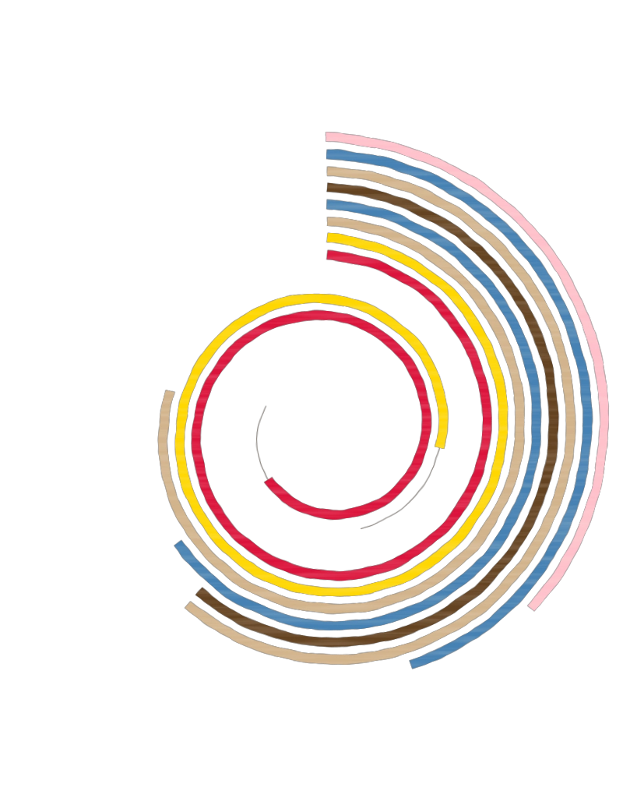

## Does automation change who gains from immigration?

Automation shifts which tasks machines perform. Immigration shifts who performs
the rest. They arrive together, and the labour market resolves them jointly ---
yet we study them apart.

I am a PhD candidate at **Paris Nanterre University**, in the **EconomiX**
research centre, supervised by **Lionel Ragot**. My thesis asks how technical
change, human capital and immigration interact in the labour market, using
French administrative data accessed through the CASD.

I came to economics through its philosophy: before this thesis I worked on
Samuelson's expected utility concept at Paris 1 Panthéon-Sorbonne, and spent a
year producing an economics programme for France Culture. Both still shape how I
choose questions and how I try to explain answers.

{.plate alt=""}

<!-- ------------------------------------------------------------------------
     RUBRIQUE "NEWS" -- retiree.
     A remettre uniquement avec des entrees VRAIES. Trois lignes maximum,
     la plus recente en haut. Un site sans news se lit comme un site jeune ;
     un site avec de fausses news se lit comme un probleme.

     ## News

     ::: {.news-item}
     **[Mois annee]** --- [evenement reel].
     :::
------------------------------------------------------------------------ -->
