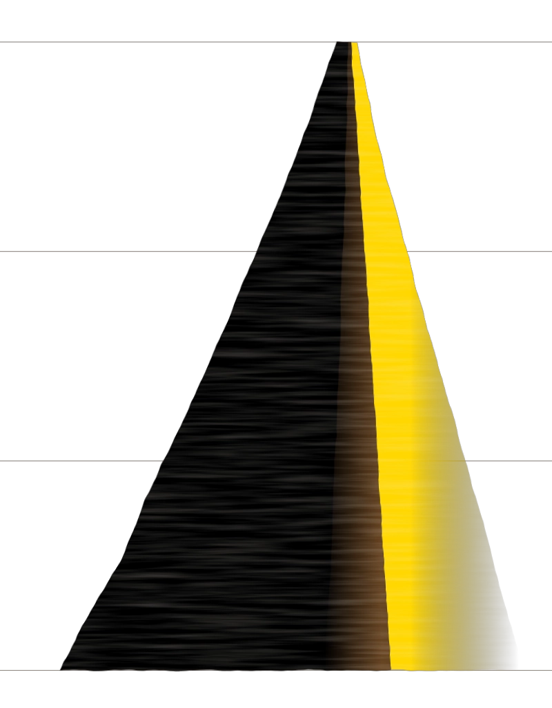

::: {.plate-row}
::: {}
Working papers and work in progress. Each paper page will carry the abstract, the
PDF, a two-minute video abstract, and whatever code can be released.

On data access: parts of this work use French administrative data accessed
through the CASD. The microdata cannot leave the enclave, but the full pipeline
and a synthetic data generator that reproduces the file structure will be
published so the analysis can be audited end to end.
:::

{.plate alt=""}
:::
